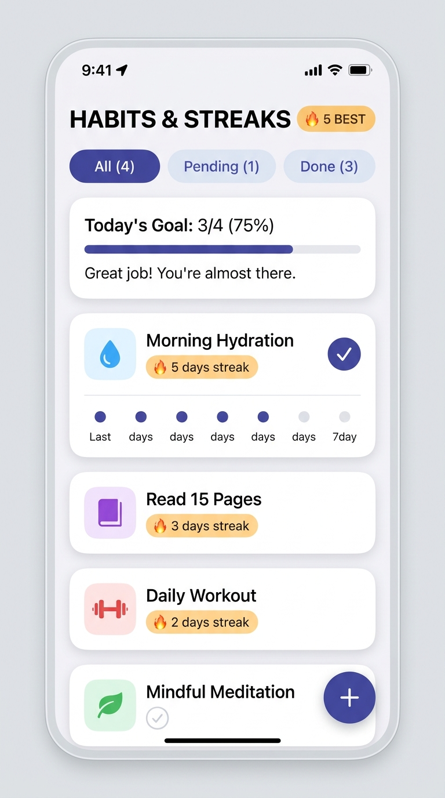
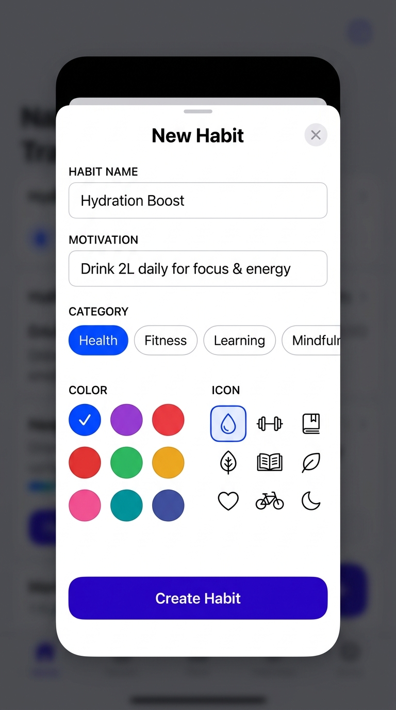

# 🔥 Habit Streak Tracker

A sleek, minimalist, offline-first React Native mobile app built with Expo, TypeScript, and AsyncStorage. It tracks daily habits, calculates active streaks, and visualizes weekly consistency with tactile micro-interactions.

---

## 📱 App Previews

<p align="center">
  
  &nbsp;&nbsp;&nbsp;&nbsp;
  
</p>

<p align="center">
  <em>Left: Dashboard with flame streak badges, 7-day mini heatmap strips, and daily progress bar.<br/>
  Right: Habit customization modal with color themes, icon selectors, and category pills.</em>
</p>

---

## ✨ Features

- **Daily Check-Off with Tactile Haptics**: Tap any habit to complete or undo with instant tactile feedback.
- **Resilient Streak Calculation**:
  - Increments streak when habits are completed on consecutive days.
  - Grace period: If you completed yesterday but haven't checked off today yet, your streak stays intact throughout the day.
  - Accurately computes personal best (longest streak) and all-time completion count.
- **7-Day Mini Heatmap Strip**: Each habit card visualizes the past 7 days (Su–Sa) with progress dots matching the habit's theme color.
- **Daily Goal Progress & Celebration Banner**:
  - Live progress bar tracking today's completion percentage (`3/4 (75%)`).
  - Trophy celebration banner unlocked when 100% of daily habits are done.
- **Filter Tabs**: Quickly toggle between **All**, **Pending**, and **Done** habits.
- **Habit Customization Modal**:
  - Custom title and optional motivation note.
  - Category selector (Health, Fitness, Learning, Mindfulness, Productivity, Lifestyle).
  - 8 curated color themes.
  - 12 category icons powered by `@expo/vector-icons`.
- **Habit Details & Management**:
  - Tap any card for a full breakdown of current streak, best streak, and total completions.
  - Edit or delete habits with confirmation dialogs.
- **Offline Persistence**: Automatically persists habits and logs locally using `@react-native-async-storage/async-storage`.

---

## 📁 Project Structure

```
habit-streak-tracker/
├── App.tsx                     # Main dashboard screen & state coordinator
├── index.ts                    # Expo entry point
├── app.json                    # Expo configuration
├── package.json
└── src/
    ├── types/
    │   └── habit.ts            # TypeScript interfaces (Habit, HabitStreakStats, etc.)
    ├── utils/
    │   ├── dateUtils.ts        # Local timezone-safe YYYY-MM-DD date helpers
    │   ├── streakCalculator.ts # Consecutive streak calculation algorithm
    │   └── __tests__/
    │       └── streakCalculator.test.ts # Unit tests for streak calculator
    ├── services/
    │   └── habitStorage.ts     # AsyncStorage CRUD and seed data
    └── components/
        ├── HeaderStats.tsx     # Top hero stats card & daily progress bar
        ├── FilterTabs.tsx      # All / Pending / Done filter pills
        ├── HabitCard.tsx       # Individual habit card with streak & 7-day strip
        ├── CelebrationBanner.tsx # 100% daily completion banner
        ├── AddHabitModal.tsx   # Modal to create or edit habits
        └── HabitDetailModal.tsx# Detailed habit statistics and delete/edit sheet
```

---

## 🚀 Getting Started

### 1. Prerequisites
- **Node.js**: v20+ or v22 LTS
- **Expo Go App** (free on iOS App Store or Google Play Store) or an iOS/Android simulator.

### 2. Run the Development Server
```bash
cd /Users/home/Developer/habit-streak-tracker
npm start
```

### 3. Open on your Device
- **Physical Device**: Open the camera app (iOS) or Expo Go app (Android) and scan the QR code displayed in the terminal.
- **iOS Simulator**: Press `i` in the terminal.
- **Android Emulator**: Press `a` in the terminal.
- **Web Browser**: Press `w` in the terminal.

---

## 🧪 Running Unit Tests

Run the test suite verifying streak algorithms and date boundaries:
```bash
npm test
```

All 5 streak calculation unit tests verify:
- Empty completions handling (0 streak).
- Today single-day completions.
- Yesterday streak preservation.
- Multi-day consecutive streaks.
- 7-day mini heatmap array structure.

---

## 📝 Git History

The project was committed in small, discrete steps:
1. `feat: install async-storage, vector-icons, and expo-haptics`
2. `feat: add habit types, streak calculator, and AsyncStorage service`
3. `feat: implement HeaderStats, FilterTabs, HabitCard, and CelebrationBanner components`
4. `feat: add AddHabitModal and HabitDetailModal with full customization`
5. `feat: connect habit dashboard, state management, FAB, and interactive modals in App.tsx`
6. `test: add unit tests for streak calculator and date algorithms`
7. `docs: add comprehensive README with setup and architecture guide`
